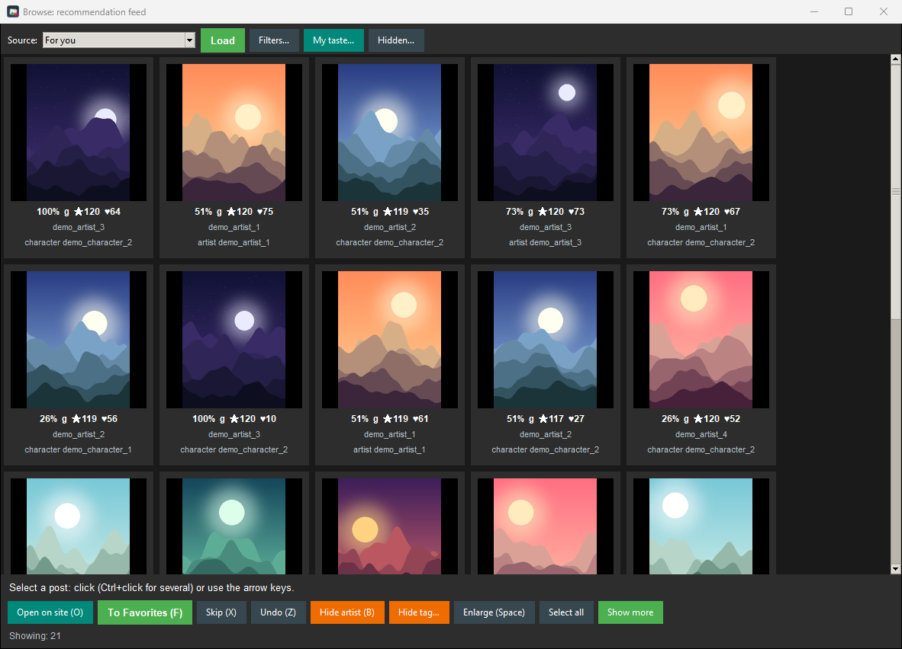
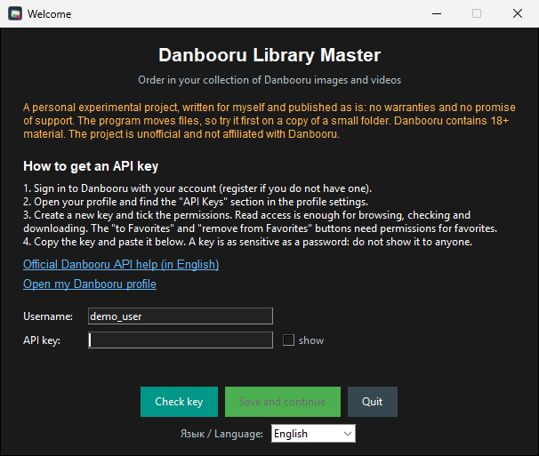
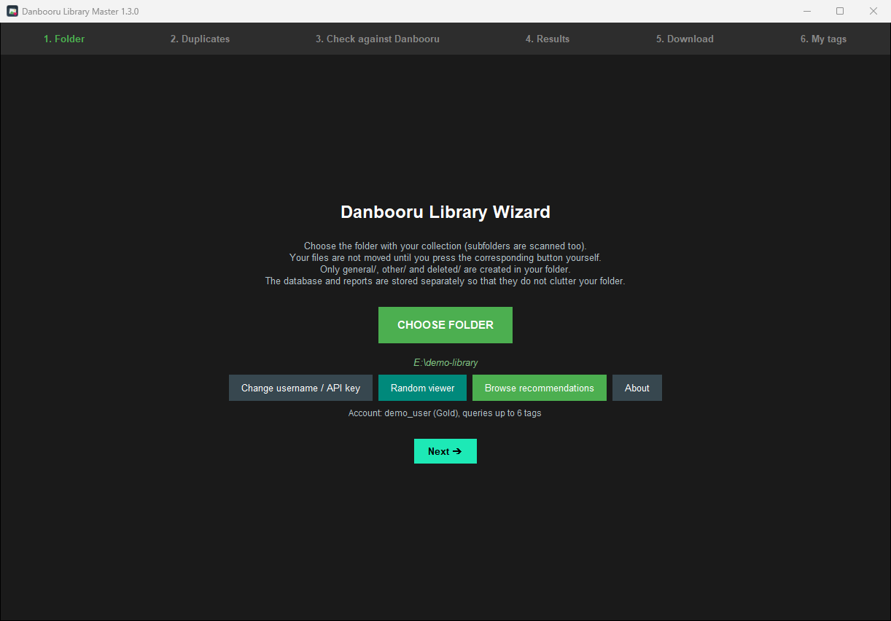
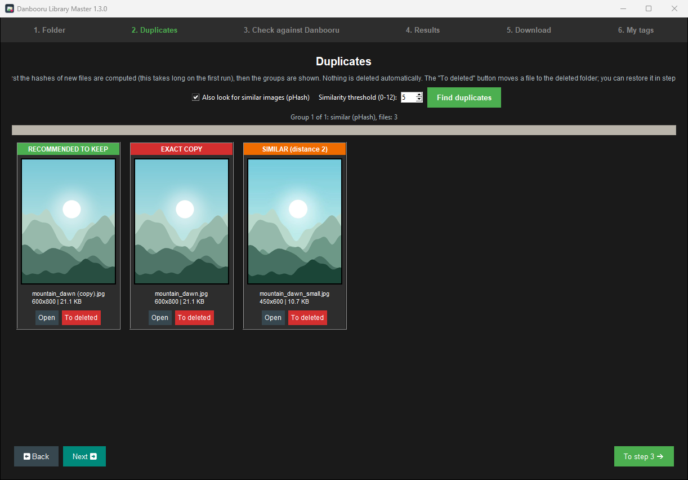
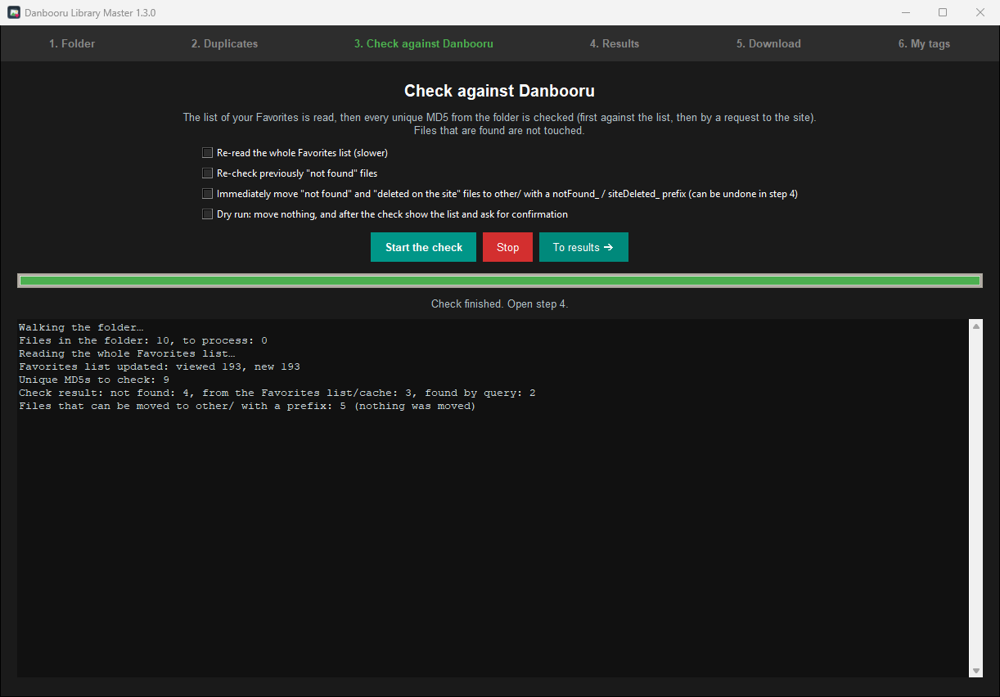
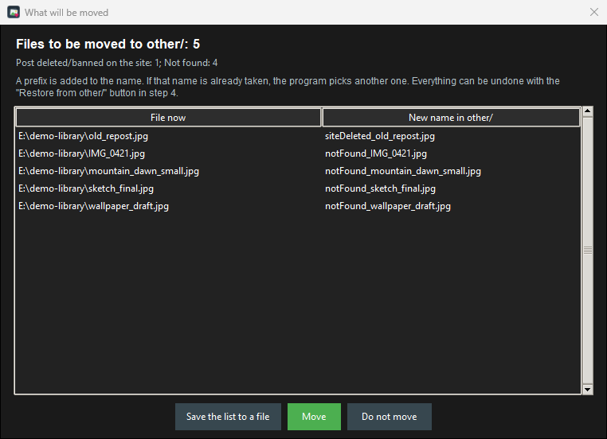
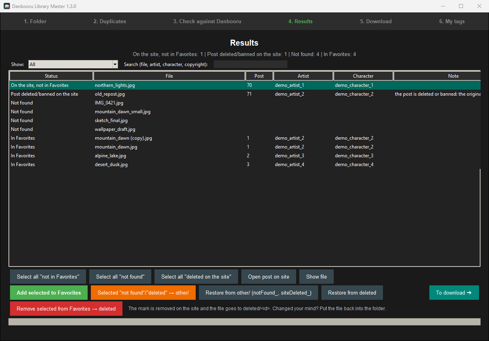
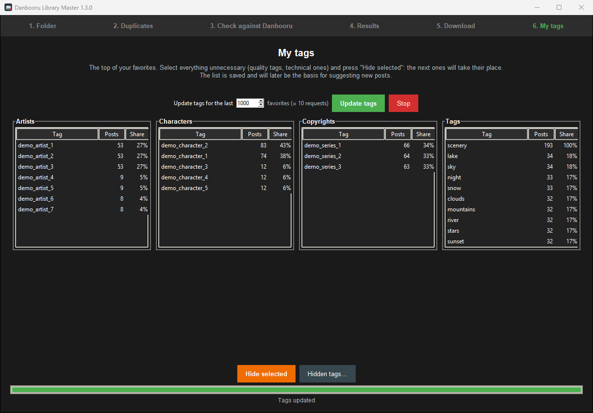
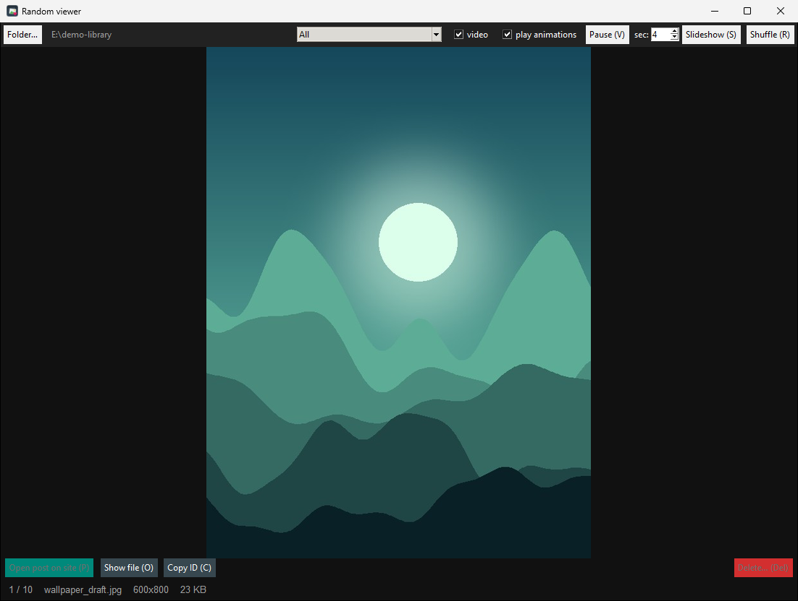

# Danbooru Library Master

[🇷🇺 Русский](README.md) · 🇬🇧 English

A Windows desktop tool that tidies up your local collection of images and videos from [Danbooru](https://danbooru.donmai.us): it checks which files exist on the site, finds duplicates, sorts files into folders, shows random pieces, and builds a small feed of new posts matching your taste. The interface is available in Russian and English.

> ⚠️ **This is a personal experimental project.** I wrote it for myself as an interesting exercise in working with a web API and publish it as is: **no warranties, no promise of support or further development**. It works for me; it may not work for you. The [MIT license](LICENSE) says the same.
>
> ⚠️ **The program moves files.** Try it first on a copy of 20-50 images. Moves are logged and can be undone with the "Restore from other/" and "Restore from deleted" buttons (Results step), but a backup never hurts. There is a **dry-run mode** that shows the list of changes and does nothing until you confirm.
>
> ⚠️ **18+.** Danbooru hosts adult content. The Browse feed shows all ratings by default (see below how to keep `general` only). This is an unofficial project, not affiliated with Danbooru.
>
> Tested **on Windows only**.

## Screenshots

The screenshots use demo data: a test account and generated images.



<details>
<summary>Other windows</summary>

**First run**



**Choosing a folder**



**Duplicates**



**Check against Danbooru**



**Move preview**



**Results**



**My tags**



**Random viewer**



</details>

## Features

- **Check against the site.** An MD5 is computed for every file and looked up on Danbooru: does the post exist, was it deleted, is it in your Favorites. Files that are found are left alone.
- **Folders.** `general/` (found), `other/` (not found / deleted on the site: files get a `notFound_` or `siteDeleted_` prefix), `deleted/` (removed from Favorites). Other file names are never changed.
- **Duplicates.** Exact (MD5) and similar images (perceptual hash, adjustable threshold). Videos are compared as exact copies only. **Nothing is deleted automatically**: groups are shown and you decide.
- **Download missing Favorites** into your folder.
- **Remove from Favorites** on the site; the file moves to `deleted/`.
- **Random viewer.** Images, GIF/WebP and mp4 in one window, with "open post on site" and "delete" buttons.
- **My tags.** Statistics of your favorites; noise tags can be hidden.
- **Browse.** A "For you" feed that finds posts from your characters, series, tags and artists, shows a match percentage and a reason on every card, and learns from every Favorite and Skip. "Time machine" digs up the best of random months from past years.
- **Account check.** The program learns your account level (free or Gold and above) and adapts (see below).
- **Two languages**, Russian and English: chosen from the system language, switchable in the "About" window.

## Quick start

1. **Create an API key.** Sign in to Danbooru, open your profile and find the "API Keys" section in the profile settings. Create a key. Read access is enough for browsing, checking and downloading; for the "to Favorites" / "remove from Favorites" buttons tick the permissions for favorites. See [Danbooru's official API help](https://danbooru.donmai.us/wiki_pages/help:api). A key is as sensitive as a password: do not show it to anyone.
2. **Start the program** (below). On the first run a window with these hints opens: enter your username and key and press "Check key". The program shows your account level.
3. **Pick a folder.** Make one folder and put your images and videos in it (subfolders are scanned). The program creates `general/`, `other/` and `deleted/` itself.
4. Follow the steps: *Folder → Duplicates → Check against Danbooru → Results → Download → My tags*. The viewer and Browse open from buttons on the first step.

### Running

**Ready-made program:** download `DanbooruLibraryMaster.exe` from the [Releases](https://github.com/Neriesa/danbooru-library-master/releases/latest) page and run it; no Python needed. The file is unsigned, so Windows SmartScreen may show a warning. The checksum is next to it in `SHA256SUMS.txt`.

**From source** (Python 3.10+):

```
pip install -r requirements.txt
python danbooru_library_master.py
```

Extra modes: `--viewer`, `--browse`, `--selftest` (environment check, no network).

**Your own build with desktop shortcuts:** double-click `build_exe.bat` and choose a build type. Three shortcuts appear. SmartScreen or an antivirus may warn about a self-built, unsigned `.exe`; running from source is always an option.

## Free account or Gold

On Danbooru, free accounts have a lower limit on the number of tags in one search than Gold accounts.

- **Check, duplicates, download, viewer, My tags** need at most 2 tags and work for everyone.
- **Browse** simplifies some queries on free accounts (for example, "best in a period" is fetched without site-side sorting and the score sorting is done on your computer). The program first tries the full query, falls back to a simpler one if the site refuses, and says so in the status line.

## Browse: how it works and how it keeps the load low

The program builds a taste profile from your Favorites (tag weights: artist > character > copyright > general tags), fetches candidates ("For you": popular plus the recent best for your characters, series, tags and artists; also popular for day/week/month, best/new by tag or artist, new from favorite artists), drops what you already have, and ranks the rest by taste, site score, variety and what you have already seen. Favorite and Skip change the order at once, and Undo (Z) reverts a skip. It is a simple statistical model: clearly better than a random feed, but some posts will still miss, which is what "Skip" and "Hide artist/tag" are for.

- Only **thumbnails** are downloaded (720 px for the large view), never originals. Lists are cached for 6 hours. The first "For you" load takes up to 13 requests, a "Time machine" load up to 12. The request and traffic counter is shown with developer settings on.
- **Ratings.** All are enabled by default. Untick `s q e` above the grid and the choice is remembered (`browse_ratings` in `config.json`, e.g. `"g"` = general only).

## Data and security

- Only `general/`, `other/` and `deleted/` are created in your picture folder.
- Everything else (database, settings, log) lives in `%LOCALAPPDATA%\DanbooruLibraryMaster`. Deleting it resets the program. The **Developer settings** switch in "About" reveals this folder, the counters and the report buttons; the HTML and duplicate reports are written only while it is on.
- **The API key** is stored in the system keyring (Windows Credential Manager) when the `keyring` package is available (included in `requirements.txt` and the `.exe` build). If no keyring is available it stays in `config.json` in plain text in your user data folder. An old key found in `config.json` is moved into the keyring automatically.
- Credentials can also be passed via the `DANBOORU_USER` and `DANBOORU_API_KEY` environment variables.
- Never publish `config.json`, databases or logs (they are in `.gitignore`); redact your key in issues.
- If a key leaks, delete it in your Danbooru profile and create a new one.
- The program only talks to Danbooru (API and image servers) on your behalf.

## Hotkeys

Cyrillic-layout equivalents work too (see the Russian README).

| Where | Keys |
|---|---|
| Random viewer | arrows / Space navigate · R shuffle · S slideshow · F / F11 fullscreen · V pause · O open in player · P open post · C copy ID · Delete remove file · mouse wheel |
| Browse | arrows · Space · F favorite · X skip · Z undo · O / Enter open on site · B hide artist · Ctrl+A select all · Esc close |

## Project layout

```
danbooru_library_master.py   entry point
dlm/
  app.py, ui*.py, dialogs.py   windows: shell, one file per step, dialogs
  net.py, account.py           Danbooru requests, account check
  db.py, files.py, imaging.py  SQLite database, files, hashes
  dupes.py, site.py, actions.py, mover.py   duplicates, check, actions, moves
  browse.py, random_viewer.py  feed and viewer
  i18n.py, locale_en.py        languages (English translations live in locale_en.py)
tests/                         automated tests and a mock Danbooru
```

Tests (no network, no account needed): `python -m unittest discover -s tests -t .` (on Linux prefix with `xvfb-run -a`). Set `DLM_LANG=ru` or `en` to choose the UI language in tests. A new UI string is written in Russian inside `_("...")` and its translation is added to `dlm/locale_en.py` (a test checks completeness).

## Known limitations

- Tested on Windows only. Other systems may not work.
- Video playback needs OpenCV; the light `.exe` build (option 3) opens videos in your default player.
- Ugoira animations are downloaded as `.webm`; MD5 is not verified for them.
- If Danbooru changes its API, some features may break.
- This is a personal project: do not expect quick fixes or new features.

## Troubleshooting

- Run `--selftest`; the report `selftest.txt` is written to the data folder.
- Error log: `booru_library.log` in the data folder. Remove any secrets before attaching it to an issue.

## License

[MIT](LICENSE). Changes: [CHANGELOG.md](CHANGELOG.md).
