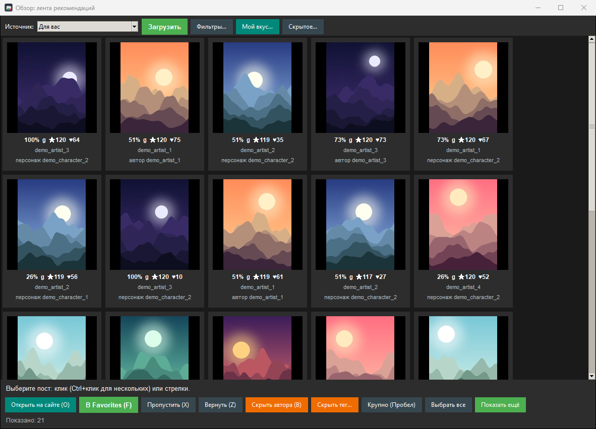
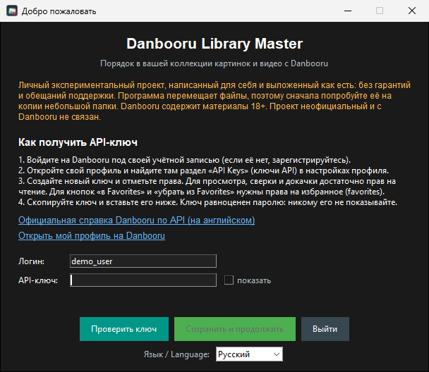
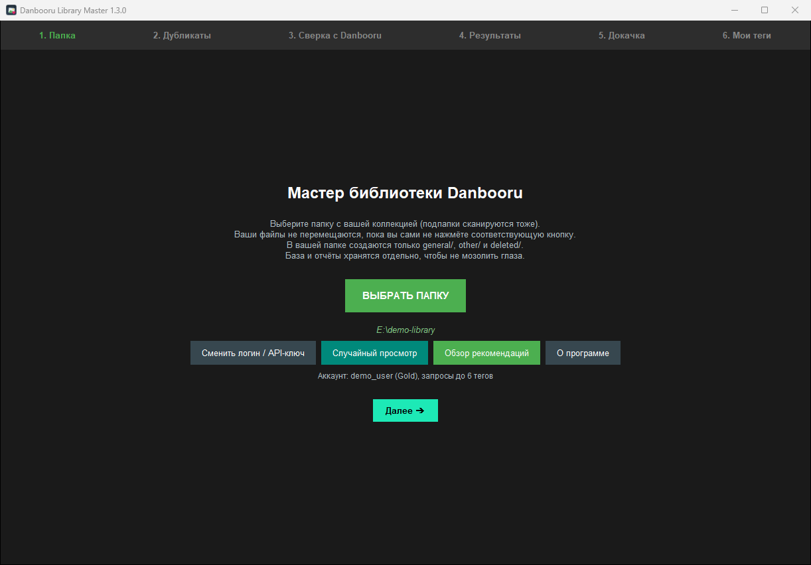
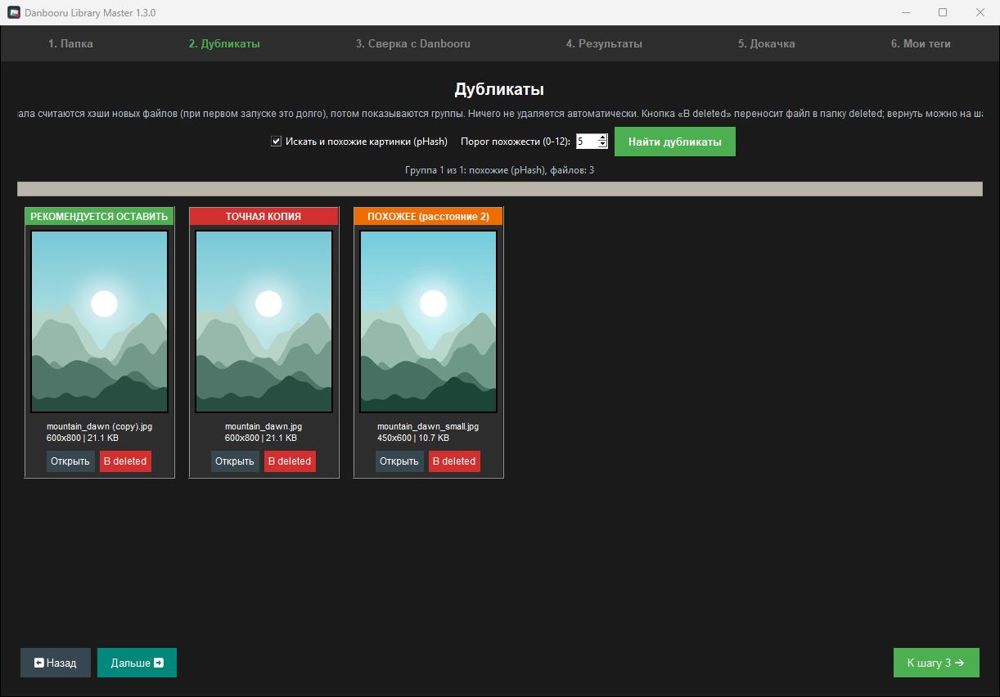
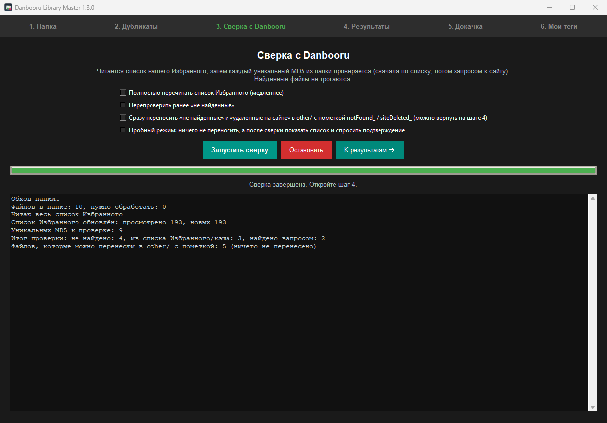
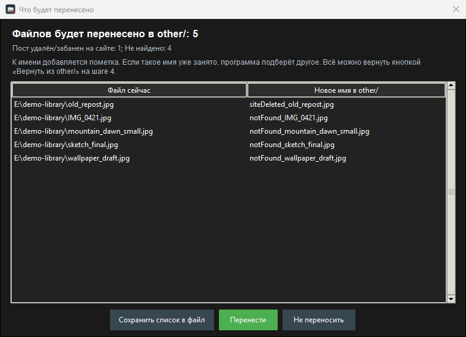
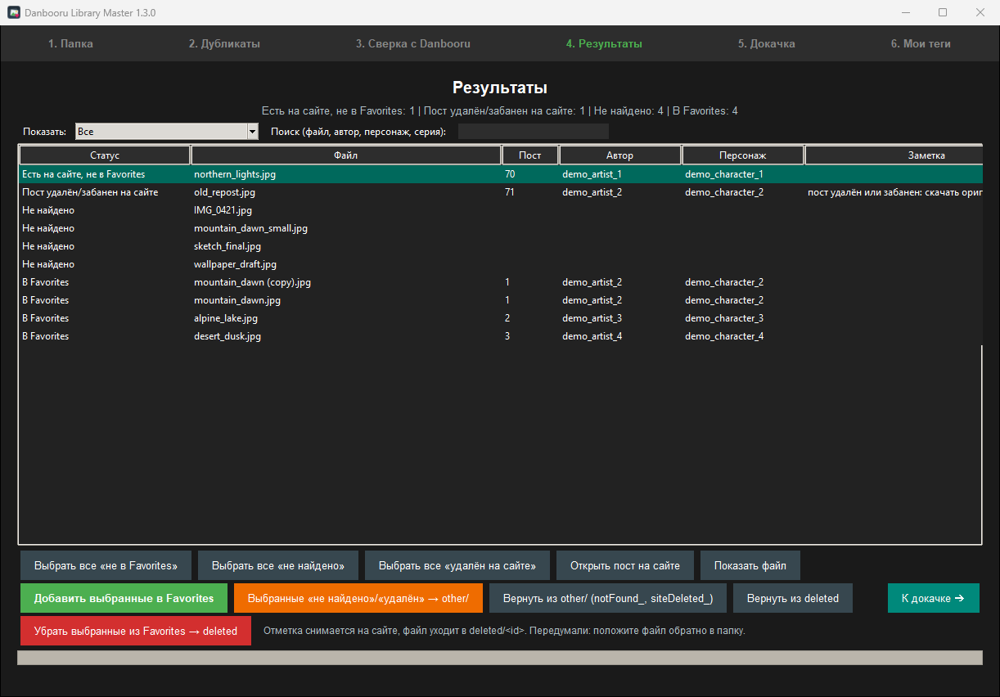
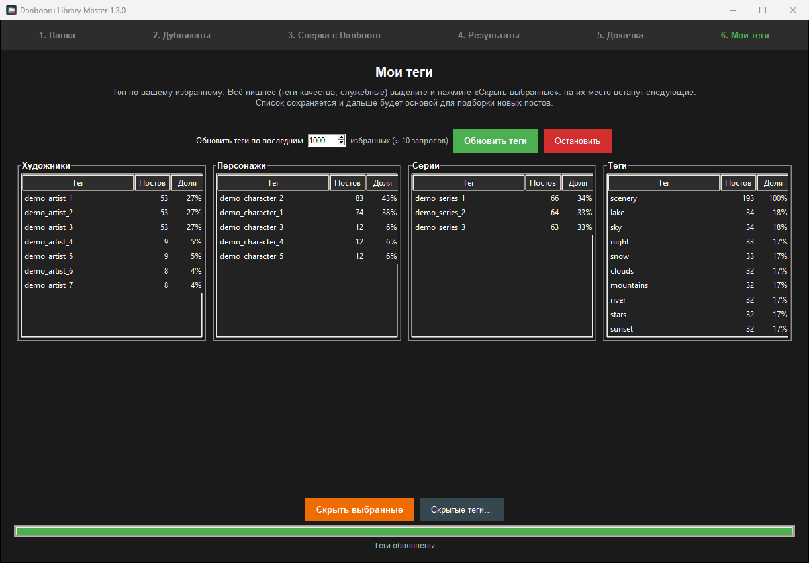
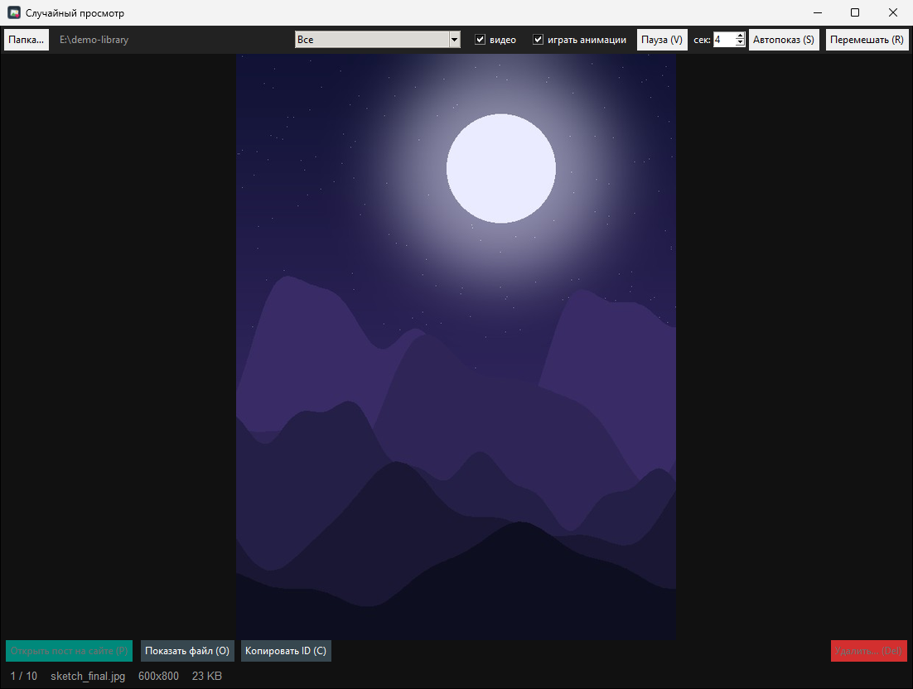

# Danbooru Library Master

🇷🇺 Русский · [🇬🇧 English](README.en.md)

Настольная программа для Windows, которая наводит порядок в вашей локальной коллекции картинок и видео с [Danbooru](https://danbooru.donmai.us): находит файлы на сайте, ищет дубликаты, раскладывает всё по папкам, показывает случайные арты и подбирает ленту новых постов под ваш вкус. Интерфейс на русском и английском.

> ⚠️ **Это личный экспериментальный проект.** Я написал его для себя как интересный опыт работы с сетью и API и выкладываю как есть: **без гарантий, без обещаний поддержки и развития**. Работает у меня, у вас может не заработать. Лицензия [MIT](LICENSE) прямо говорит то же самое.
>
> ⚠️ **Программа перемещает файлы.** Для первого знакомства скопируйте в отдельную папку 20–50 картинок и пробуйте на них. Перемещения записываются в журнал и отменяются кнопками «Вернуть из other/» и «Вернуть из deleted» (шаг «Результаты»), но резервная копия никогда не лишняя. Есть **пробный режим**: он показывает список изменений и ничего не делает, пока вы не подтвердите.
>
> ⚠️ **18+.** Danbooru содержит материалы для взрослых. Лента «Обзор» по умолчанию показывает все рейтинги (как оставить только `general`, см. ниже). Проект неофициальный и с Danbooru не связан.
>
> Проверялось **только на Windows**.

## Скриншоты

На скриншотах демо-данные: тестовый аккаунт и сгенерированные картинки.



<details>
<summary>Остальные окна</summary>

**Первый запуск**



**Выбор папки**



**Дубликаты**



**Сверка с Danbooru**



**Предпросмотр переноса**



**Результаты**



**Мои теги**



**Случайный просмотр**



</details>

## Что умеет

- **Сверка с сайтом.** Для каждого файла считается MD5 и проверяется, есть ли пост на Danbooru, не удалён ли он и лежит ли в ваших Favorites. Найденные файлы программа не трогает.
- **Папки для удобства.** `general/` (найдено), `other/` (не найдено и удалено на сайте: файлы получают приставки `notFound_` и `siteDeleted_`), `deleted/` (то, что вы убрали из Favorites). Остальные имена файлов не меняются.
- **Дубликаты.** Точные (по MD5) и похожие картинки (перцептивный хэш, порог настраивается). Видео сравниваются только как точные копии. Программа **ничего не удаляет сама**: она показывает группы, а решаете вы.
- **Докачка Favorites.** Недостающие посты из вашего избранного скачиваются в папку.
- **Убрать из Favorites** на сайте с переносом файла в `deleted/`.
- **Случайный просмотр.** Картинки, GIF/WebP и mp4 в одном окне, кнопки «Открыть пост на сайте» и «Удалить».
- **Мои теги.** Статистика по вашему избранному, лишние теги можно скрыть.
- **Обзор.** Лента «Для вас»: сама находит посты по вашим персонажам, сериям, тегам и авторам, показывает процент совпадения и причину, учится на каждом «в Favorites» и «Пропустить». «Машина времени» достаёт лучшее из случайных месяцев прошлых лет.
- **Проверка аккаунта.** Программа узнаёт ваш уровень (бесплатный или Gold и выше) и подстраивается (см. ниже).
- **Два языка**, русский и английский: выбираются по языку системы, переключаются в окне «О программе».

## Быстрый старт

1. **Создайте API-ключ.** Войдите на Danbooru, откройте профиль и найдите раздел «API Keys» в настройках профиля. Создайте ключ. Для просмотра, сверки и докачки достаточно прав на чтение; для кнопок «в Favorites» и «убрать из Favorites» отметьте права на избранное. Подробности есть в [официальной справке Danbooru по API](https://danbooru.donmai.us/wiki_pages/help:api) (на английском). Ключ равноценен паролю: никому его не показывайте.
2. **Запустите программу** (см. ниже). При первом запуске откроется окно со всеми этими подсказками: введите логин и ключ и нажмите «Проверить ключ». Программа покажет ваш уровень аккаунта.
3. **Выберите папку с картинками.** Создайте одну папку, сложите в неё картинки и видео (вложенные папки сканируются). Подпапки `general/`, `other/` и `deleted/` программа создаст сама.
4. Идите по шагам: *Папка → Дубликаты → Сверка с Danbooru → Результаты → Докачка → Мои теги*. Случайный просмотр и «Обзор» открываются кнопками на первом шаге.

### Запуск

**Готовая программа:** скачайте `DanbooruLibraryMaster.exe` со страницы [Releases](https://github.com/Neriesa/danbooru-library-master/releases/latest) и запустите его, Python не нужен. Файл не подписан, поэтому Windows SmartScreen может показать предупреждение. Контрольная сумма лежит рядом в `SHA256SUMS.txt`.

**Из исходников** (Python 3.10+):

```
pip install -r requirements.txt
python danbooru_library_master.py
```

Дополнительные режимы: `--viewer` (случайный просмотр), `--browse` (лента), `--selftest` (проверка окружения без сети).

**Своя сборка с ярлыками на рабочем столе:** дважды щёлкните `build_exe.bat` и выберите тип сборки. Появятся три ярлыка. Если Windows SmartScreen или антивирус ругается на самостоятельно собранный `.exe`, это обычная реакция на неподписанные программы; из исходников запускать можно всегда.

## Бесплатный аккаунт или Gold

У Danbooru у бесплатных аккаунтов ниже лимит тегов в одном поисковом запросе, чем у Gold.

- **Сверка, дубликаты, докачка, просмотр, «Мои теги»** укладываются в 2 тега и работают у всех.
- **«Обзор»** у бесплатных аккаунтов упрощает часть запросов (например, «лучшее за период» берётся без сортировки на стороне сайта, а сортировка по очкам делается у вас). Программа сама пробует полный запрос, при отказе переходит к упрощённому и пишет об этом в строке состояния.

## Обзор: как это работает и как не перегружать сайт

Программа строит профиль вкуса по вашим Favorites (веса тегов: художник > персонаж > серия > обычные теги), берёт кандидатов («Для вас»: популярное плюс лучшее из недавнего по вашим персонажам, сериям, тегам и авторам; также популярное за день/неделю/месяц, лучшее и новое по тегу или автору, новое у любимых авторов), убирает уже добавленное и сортирует с учётом вкуса, очков сайта, разнообразия и того, что уже показывали. «В Favorites» и «Пропустить» меняют порядок сразу, «Вернуть (Z)» отменяет пропуск. Про качество честно: это простая статистическая модель, а не магия. Она заметно лучше случайной ленты, но часть показанного будет мимо вкуса: для этого есть «Пропустить» и «Скрыть автора или тег».

- Скачиваются **только миниатюры** (крупно: 720 px), оригиналы нет. Списки кэшируются на 6 часов. Первая загрузка «Для вас» занимает до 13 запросов, загрузка «Машины времени» до 12. Счётчик запросов и трафика виден в настройках разработчика.
- **Рейтинги.** По умолчанию включены все. Снимите галочки `s q e` над сеткой, и выбор запомнится (в `config.json` ключ `browse_ratings`, например `"g"` = только general).

## Где что хранится и безопасность

- В вашей папке с картинками создаются только `general/`, `other/` и `deleted/`.
- Всё служебное (база, настройки, журнал) лежит в `%LOCALAPPDATA%\DanbooruLibraryMaster`. Переключатель **«Настройки разработчика»** в окне «О программе» показывает эту папку, счётчики и кнопки отчётов; HTML-отчёт и отчёт о дубликатах создаются только при включённом режиме. Эту папку можно удалить, программа начнёт с нуля.
- **API-ключ** хранится в системном хранилище паролей (Windows Credential Manager), если установлен пакет `keyring` (он есть в `requirements.txt` и в сборке `.exe`). Если хранилище недоступно, ключ лежит в `config.json` открытым текстом в папке данных вашего пользователя. Старый ключ из `config.json` переносится в хранилище автоматически.
- Ключ можно передать и переменными окружения `DANBOORU_USER` и `DANBOORU_API_KEY`.
- Не публикуйте `config.json`, базы и журналы (они уже в `.gitignore`), а в issues скрывайте ключ.
- Если ключ утёк: удалите его в профиле Danbooru и создайте новый.
- Программа общается только с Danbooru (API и серверы изображений) от вашего имени.

## Горячие клавиши

Работают и в русской раскладке.

| Где | Клавиши |
|---|---|
| Случайный просмотр | стрелки / пробел листать · R (К) перемешать · S (Ы) автопоказ · F (А) / F11 полный экран · V (М) пауза · O (Щ) открыть в плеере · P (З) пост на сайте · C (С) копировать ID · Delete убрать файл · колесо мыши листать |
| Обзор | стрелки · пробел · F (А) в Favorites · X (Ч) пропустить · Z (Я) вернуть · O (Щ) / Enter открыть на сайте · B (И) скрыть автора · Ctrl+A выбрать всё · Esc закрыть |

## Устройство проекта

```
danbooru_library_master.py   точка входа
dlm/
  app.py, ui*.py, dialogs.py   окна: каркас, по файлу на каждый шаг, диалоги
  net.py, account.py           запросы к Danbooru, проверка аккаунта
  db.py, files.py, imaging.py  база SQLite, файлы, хэши
  dupes.py, site.py, actions.py, mover.py   дубликаты, сверка, действия, перемещения
  browse.py, random_viewer.py  лента и просмотр
  i18n.py, locale_en.py        языки (английский перевод в locale_en.py)
tests/                         автотесты и поддельный Danbooru
```

Тесты (без сети и без вашего аккаунта): `python -m unittest discover -s tests -t .` (на Linux с `xvfb-run -a`). Язык в тестах: переменная `DLM_LANG=ru` или `en`. Новая строка интерфейса пишется по-русски в `_("...")`, а её перевод добавляется в `dlm/locale_en.py` (тест проверит полноту).

## Известные ограничения

- Проверялось только на Windows. На других системах может не работать.
- Для видео нужен OpenCV. В лёгкой сборке `.exe` (вариант 3) видео открываются обычным плеером.
- Анимации ugoira скачиваются как `.webm`, MD5 для них не проверяется.
- Если Danbooru изменит API, часть функций может перестать работать.
- Проект личный: не ждите быстрых исправлений и новых функций.

## Если что-то не работает

- Выполните `--selftest` (отчёт `selftest.txt` в папке данных).
- Журнал ошибок: `booru_library.log` в папке данных. Перед отправкой в issue уберите из него ключ.

## Лицензия

[MIT](LICENSE). Список изменений: [CHANGELOG.md](CHANGELOG.md).
